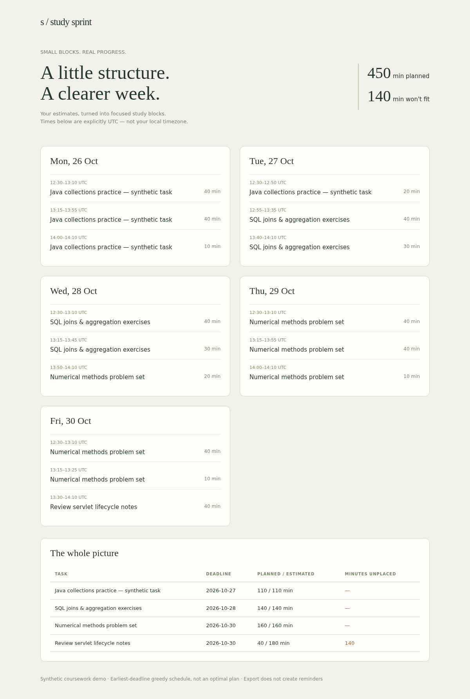

# Study Sprint Planner

Convert estimated coursework into a capacity-aware study timetable, flag work that cannot fit before its deadline, and export a printable HTML plan plus an importable calendar file.

## Quick start

```sh
python planner.py sample/coursework.json --out output
# Open output/plan.html; optional calendar import: output/study.ics
```
Edit the synthetic JSON: explicit start date, days, weekday availability, daily UTC start and minutes, tasks with inclusive deadlines and estimated minutes. Existing nonempty output directories are refused.

## Tests

`python -m unittest discover -s tests -v`

## Scope and limitations

Deterministic earliest-deadline greedy planning, not an optimal scheduler or reminder service. Estimates are user inputs; unscheduled work stays explicit. All event times are UTC, never inferred from location; convert the chosen UTC time yourself before calendar import. Calendar files are only exported, not uploaded. Synthetic example is fixed to October 2026. No account connection, diagnosis or learning-performance claims.

## Attribution and sample data

Built for Raj's portfolio with Wabi AI assistance. Sample data is invented and labelled synthetic; no real customer, employer or private account records are included. This is a learning/portfolio implementation, not a claim of commercial work or production deployment.

See source and tests for implementation decisions. Use invented data when exploring.

## How it works

Validated tasks and explicit UTC availability → earliest-deadline greedy sessions with breaks → JSON + print-friendly HTML + iCalendar export. Unplaced minutes remain in the report.

## Verified example

Synthetic example produced15 sessions,450 scheduled and140 unscheduled minutes. Browser rendering inspected; ICS UTC timestamps/escaping/folding and nonoverlap tested. Calendar was not imported into an account.

See [VALIDATION.md](VALIDATION.md) for tested environments and scope.


